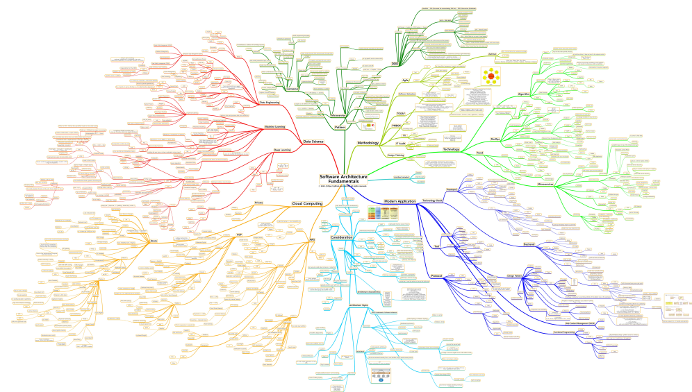

# Software Architecture Mindmap

- This repository was initially created for the mind map; currently, it is used as a curated collection of software architecture references. 
- This mind map is based on the Fresco Play curriculum (the internal learning platform of Tata Consultancy Services). © 2022 

    

## Contents

- **Section 1**: [Software Architecture Mindmap](#software-architecture-mindmap)
- **Section 2**: [Software Architecture Reference](#software-architecture-reference)
    - [Trend Reports](#trend-reports)
    - [Industry Trends](#industry-trends)
    - [Newsletter](#newsletter)
    - [Mini-Books](#mini-books)
    - [Building from scratch](#building-from-scratch)
    - [Cloud Architecture](#cloud-architecture)
    - [Computer Science courses](#computer-science-courses)
    - [Beginner Series by Microsoft](#beginner-series-by-microsoft)
    - [Tools & Research](#tools--research)
    - [Engineering blog](#engineering-blog)
    - [Other Topics](#other-topics)
    - [Transformer Architecture (LLM Foundations)](#transformer-architecture-llm-foundations)
- **Section 3**: [Computer Science Books](#computer-science-books)
- **Section 4**: [Computer Science Papers](#computer-science-papers)
    - [Computer Science Papers Every Developer Should Read](#computer-science-papers-every-developer-should-read)
    - [70+ Distributed Systems papers](#70-distributed-systems-papers)
    - [25 Papers That Completely Transformed the Computer World](#25-papers-that-completely-transformed-the-computer-world)
    - [The best NLP papers from 2015 to now](#the-best-nlp-papers-from-2015-to-now)
- **Section 5**: [Data Science (ML/NN)](#data-science-mlnn)
    - [Machine Learning, Data Science & AI Books](#machine-learning-data-science--ai-books)
    - [Machine Learning, Data Science & AI Repositories](#machine-learning-data-science--ai-repositories)
- **Section 6**: [Terminology and Comparisons](#terminology-and-comparisons)
- **Section 7**: [Sources and Notes](#sources-and-notes)

Software terminologies and concepts, software architecture overview

Software_Architecture_Mindmap.png: Application development, Cloud Computing, and Data science.

> [!TIP]  
> The mindmap can be opened and edited using [mindmap-maker-clean](https://github.com/kimtth/mindmap-maker-clean). You can also use it to convert the JSON source into a high-resolution PNG. Verified on Chrome and Firefox.

---

## Software Architecture Reference

- [System Design 101](https://github.com/ByteByteGoHq/system-design-101): 🗺️ByteByteGo. System design basics explained with diagrams
- [Awesome Lists](https://github.com/sindresorhus/awesome): 🗂️Lists of useful links on many topics / `awesome.re` / [github topic](https://github.com/topics/awesome)
- [Ecosyste.ms: Awesome](https://awesome.ecosyste.ms/): Searchable index of awesome lists
- [Awesome Software Architecture (simskij)](https://github.com/simskij/awesome-software-architecture): Architecture patterns, principles, and tools
- [Awesome Software Architecture](https://github.com/mehdihadeli/awesome-software-architecture): Articles, videos, patterns, and principles
- [Software Architecture Books](https://github.com/mhadidg/software-architecture-books): Books on architecture styles, principles, and choices
- [System Design](https://github.com/karanpratapsingh/system-design): Scaling systems to more users; interview study
- [Microsoft .NET Application Architecture - Reference Apps](https://github.com/dotnet-architecture/eShopOnWeb): Example online store built with ASP.NET Core
- [System Design Fight Club](https://github.com/systemdesignfightclub/SDFC): Example system design discussions
- [System Design - Neo Kim](https://github.com/systemdesign42/system-design): Concept notes and interview prep
- [Awesome System Design Resources](https://github.com/ashishps1/awesome-system-design-resources): Links for system design interview study
- [Awesome Low Level Design (LLD) / Object Oriented Design (OOD)](https://github.com/ashishps1/awesome-low-level-design): Class and object design; interview practice
- [Awesome Engineering Articles](https://github.com/ashishps1/awesome-engineering-articles): Engineering articles from technology companies

### Trend Reports

- [InfoQ](https://www.infoq.com): News and Articles
- [InfoQ Trends Reports](https://www.infoq.com/infoq-trends-report/): 📖([Downloaded PDFs 2019 and 2021 - 2025](./files/infoq_trends_report/))
- [Dzone](https://dzone.com/): RefCards and Trend Reports
- [Thoughtworks](https://www.thoughtworks.com/radar): Technology Radar 📖([archived PDFs vo.1 - vol.34](./files/tech_radar_thoughtworks/))
- [Microsoft Learn](https://learn.microsoft.com/en-us/): 🪟Documentation and Code samples
- [Trendshift](https://trendshift.io/): GitHub Trending repositories
- [Design Gurus](https://www.designgurus.io/): Portal For Tech Interviews

### Industry Trends

- [Software Industry Statistics](https://www.statista.com/markets/418/topic/484/software/#overview): Statista market figures
- [Gartner Top Strategic Technology Trends 2024](https://www.gartner.com/en/articles/gartner-top-10-strategic-technology-trends-for-2024): Ten key technology trends for 2024
- [MAD (ML/AI/Data) Landscape](https://mad.firstmark.com/): Map of companies in AI, machine learning, and data
- [Hype Cycle for Emerging Technologies 2024](https://www.gartner.com/en/newsroom/press-releases/2024-08-21-gartner-2024-hype-cycle-for-emerging-technologies-highlights-developer-productivity-total-experience-ai-and-security): New technologies and how mature each one is
- [Microsoft Digital Defense Report](https://aka.ms/MDDR): Cyber threat and protection trends
- [Google DORA](https://dora.community/): DevOps performance research and metrics
- [Postman State of the API Report](https://www.postman.com/state-of-api): Survey on API usage and tooling
- [Stanford AI Index Annual Report](https://hai.stanford.edu/ai-index): Yearly data on AI research, spending, and policy
- [State of Devs](https://stateofdevs.com/en-US)

### Newsletter

- [Substack Leaderboard](https://substack.com/browse/technology): Technology newsletters on Substack
- [daily.dev](https://app.daily.dev): Personalized developer feed
- [Hacker News](https://news.ycombinator.com/)

### Mini-Books

- 🆓 [Building Evolutionary Architectures](https://www.infoq.com/minibooks/evolutionary-architecture/): InfoQ mini-book on guiding architecture to change over time with fitness functions
- [System Design Blueprint: The Ultimate Guide](https://blog.bytebytego.com/p/ep56-system-design-blueprint-the): Component checklist
- 🆓 [InfoQ minibooks](https://www.infoq.com/minibooks/): Architectures You’ve Always Wondered About 📖[2021](./files/minibooks/AYAWA-2021-1635782607730.pdf) / [2023](./files/minibooks/AYAWA-2023-1685636455618.pdf) / [2024](./files/minibooks/AYAWA-2024-1712241257109.pdf) /[2025](./files/minibooks/AYAWA-2025-1745910098236.pdf) / [Cell-Based Architecture](https://www.infoq.com/minibooks/cell-based-architecture-2024)
- 🆓 [Building a scalable authorization system](./files/minibooks/Building%20a%20scalable%20authorization%20system_%20a%20step-by-step%20blueprint.pdf): How to design permissions for growing systems
- 🆓 [Mastering RAG](./files/minibooks/Mastering%20RAG-compressed.pdf): Retrieval-augmented generation guide
- 🆓 [Mastering AI Agents](./files/minibooks/Mastering%20AI%20Agents-compressed.pdf): AI agent guide
- 🆓 [Agentic Architectures for Retrieval-intensive Applications](./files/minibooks/Weaviate%20Agentic%20Architectures-ebook.pdf): AI agents for search-based apps
- 🆓 [Programming Notes for Professionals books](https://goalkicker.com/): Free reference books for languages and tools
- 🆓 [Google SRE Handbook](https://sre.google/sre-book/monitoring-distributed-systems/#xref_monitoring_golden-signals): Monitoring and the four golden signals

### Building from scratch

- [How does a request travel in ~200ms?](https://200ms.thenodebook.com/)
- [Let's Build a Simple Database](https://cstack.github.io/db_tutorial/): SQLite-like database in C
- [Let’s Build A Simple Interpreter](https://ruslanspivak.com/lsbasi-part1/): Interpreter in Python, step by step
- [Let’s Build A Web Server](https://ruslanspivak.com/lsbaws-part1/): Web server in Python, step by step
- [Web Browser Engineering](https://browser.engineering/): Small web browser, from networking to rendering
- [Clone Wars](https://github.com/GorvGoyl/Clone-Wars): Open-source copies of well-known websites
- [Curated list of project-based tutorials](https://github.com/practical-tutorials/project-based-learning): Projects grouped by programming language
- [Master programming by recreating your favorite technologies from scratch](https://github.com/codecrafters-io/build-your-own-x): Rebuild databases, shells, and more
- [Build frontend applications at scale](https://frontendatscale.com/courses/frontend-architecture/): Organizing large web applications
- [Writing an Operating System in 1,000 Lines](https://github.com/nuta/operating-system-in-1000-lines): Small OS kernel
- [minimal GPT](https://www.k-a.in/minimalGPT.html): Small GPT model in code
- [PyTorch internals](https://blog.ezyang.com/2019/05/pytorch-internals/): How PyTorch tensors and operators work inside
- [JavaScript Runtime from Scratch](https://devlogs.xyz/blog/building-a-javaScript-runtime): JavaScript runtime in C

### Cloud Architecture

- [AWS to Azure services comparison](https://learn.microsoft.com/en-us/azure/architecture/aws-professional/services): AWS services and the matching Azure services
- [Google Cloud to Azure services comparison](https://learn.microsoft.com/en-us/azure/architecture/gcp-professional/services): Google Cloud services and the matching Azure services
- [Compare AWS and Azure services to Google Cloud](https://cloud.google.com/docs/get-started/aws-azure-gcp-service-comparison): Table that maps AWS and Azure services to Google Cloud
- [Microsoft Azure Developer's Cheat Sheet](https://github.com/milanm/azure-cheat-sheet): Quick reference of Azure products and features
- [Azure Cloud Adoption Framework :CAF](https://learn.microsoft.com/en-gb/azure/cloud-adoption-framework/): How a company plans and starts using Azure
- [Azure Well-architected Framework :WAF](https://learn.microsoft.com/en-us/azure/well-architected/): Rules for building and improving cloud applications
- [Azure Architecture Center :AAC](https://learn.microsoft.com/en-us/azure/well-architected/service-guides/?product=popular): Patterns and reference architectures
- [Best practices in cloud applications](https://learn.microsoft.com/en-us/azure/architecture/best-practices/index-best-practices): Caching, retries, scaling, and similar topics
- [Cloud Design Patterns](https://learn.microsoft.com/en-us/azure/architecture/patterns/): Standard solutions to common cloud problems
- [Landing zone](https://learn.microsoft.com/en-us/azure/cloud-adoption-framework/ready/landing-zone): Design guide for a proven and flexible Azure architecture
- [Resources for architects and developers of multitenant solutions](https://learn.microsoft.com/en-us/azure/architecture/guide/multitenant/related-resources): Multitenant SaaS design links
- [Data partitioning strategies](https://learn.microsoft.com/en-us/azure/architecture/best-practices/data-partitioning-strategies): Splitting data across storage
- [Azure FinOps Guide](https://techcommunity.microsoft.com/t5/fasttrack-for-azure/the-azure-finops-guide/bc-p/4237205#M1023): Cloud cost management
- [Modern Web App pattern for .NET](https://learn.microsoft.com/en-us/azure/architecture/web-apps/guides/enterprise-app-patterns/modern-web-app/dotnet/guidance) / [git](https://github.com/Azure/modern-web-app-pattern-dotnet): Design guide with sample .NET app
- [AI agent orchestration patterns](https://learn.microsoft.com/en-us/azure/architecture/ai-ml/guide/ai-agent-design-patterns#implementations-in-microsoft-semantic-kernel): How to make several AI agents work together

### Computer Science courses

- AI learning portals: [Anthropic Academy](https://anthropic.skilljar.com/), [Google AI Training](https://grow.google/ai), [Meta AI Resources](https://ai.meta.com/resources/), [NVIDIA CUDA](https://developer.nvidia.com/cuda), [Microsoft Learn](https://learn.microsoft.com/en-us/training/), [OpenAI Academy](https://academy.openai.com/), [IBM SkillsBuild](https://skillsbuild.org/), [AWS Skill Builder](https://skillbuilder.aws/), [DeepLearning.AI](https://www.deeplearning.ai/), and [Hugging Face Learn](https://huggingface.co/learn)
- [Kaggle Solutions and Ideas](https://github.com/faridrashidi/kaggle-solutions): Examples from Kaggle competitions
- [Best-of Machine Learning with Python](https://github.com/ml-tooling/best-of-ml-python): Ranked Python machine learning libraries, updated weekly
- [freeCodeCamp](https://www.freecodecamp.org): Free coding lessons and exercises. [youtube](https://www.youtube.com/freecodecamp)
- [Ultimate Collection of 60 YouTube Courses for 21 Programming Languages](https://dev.to/arjuncodess/ultimate-collection-of-60-youtube-courses-for-21-programming-languages-mega-list-47b5): YouTube courses by language
- [Computer Science courses with video lectures](https://github.com/Developer-Y/cs-video-courses): University lectures grouped by topic
- [Introduction to CUDA Programming for Python Developers](https://www.pyspur.dev/blog/introduction_cuda_programming): Using NVIDIA GPUs from Python
- [AI by Hand](https://by-hand.ai): Work through AI calculations by hand | [AI by Hand - Solutions](https://github.com/kimtth/learn-ai-by-hand-solution)
- [Computer Networking Fundamentals](https://labs.iximiuz.com/courses/computer-networking-fundamentals): Networking lessons with online labs

### Beginner Series by Microsoft

- [Generative AI for Beginners](https://github.com/microsoft/generative-ai-for-beginners?WT.mc_id=academic-105485-koreyst): Building apps with generative AI
- [ML for Beginners](https://github.com/microsoft/ML-For-Beginners?WT.mc_id=academic-105485-koreyst): Classical machine learning
- [Web Dev for Beginners](https://github.com/microsoft/Web-Dev-For-Beginners?WT.mc_id=academic-0000-abartolo): HTML, CSS, and JavaScript
- [AI for Beginners](https://github.com/microsoft/ai-for-beginners?WT.mc_id=academic-105485-koreyst): Basic AI lessons
- [Data Science for Beginners](https://github.com/microsoft/Data-Science-For-Beginners?WT.mc_id=academic-105485-koreyst): Analyzing data and showing results
- [IoT for Beginners](https://github.com/microsoft/IoT-For-Beginners?WT.mc_id=academic-105485-koreyst): Projects with sensors, devices, and cloud
- [AI Agents for Beginners](https://github.com/microsoft/ai-agents-for-beginners): AI agent lessons
- [Cybersecurity for Beginners](https://github.com/microsoft/Security-101?WT.mc_id=academic-96948-sayoung): Basic security lessons
- [Model Context Protocol (MCP) For Beginners](https://github.com/microsoft/mcp-for-beginners?WT.mc_id=academic-105485-koreyst): Connecting AI apps to tools and data
- [Generative AI for Beginners using .NET](https://github.com/microsoft/Generative-AI-for-beginners-dotnet?WT.mc_id=academic-105485-koreyst): Generative AI examples in C# and .NET
- [Mastering GitHub Copilot for C#/.NET Developers](https://github.com/microsoft/mastering-github-copilot-for-dotnet-csharp-developers?WT.mc_id=academic-105485-koreyst): Copilot examples for C# and .NET
- [Choose Your Own Copilot Adventure](https://github.com/microsoft/CopilotAdventures?WT.mc_id=academic-105485-koreyst): Coding challenges with GitHub Copilot
- [XR Development for Beginners](https://github.com/microsoft/xr-development-for-beginners?WT.mc_id=academic-105485-koreyst): AR, VR, and mixed reality
- [Mastering GitHub Copilot for AI Paired Programming](https://github.com/microsoft/Mastering-GitHub-Copilot-for-Paired-Programming?WT.mc_id=academic-113596-abartolo): Using Copilot to write, test, and review code

### Tools & Research

##### Algorithm & Visualization
- [Algorithm Visualizer](https://github.com/algorithm-visualizer/algorithm-visualizer): Watch algorithms run step by step
- [Netron](https://github.com/lutzroeder/netron): View layers and connections of a machine learning model
- [Hello Algo](https://www.hello-algo.com/en/): Illustrated lessons on algorithms and data structures
- [Wikipedia: List of Algorithms](https://www.wikiwand.com/en/articles/List_of_algorithms): Algorithms listed by type

##### Design Patterns & Development
- [System Design Notes](https://github.com/liquidslr/system-design-notes): Chapter-by-chapter notes on System Design Interview books
- [Paperdraw](https://paperdraw.dev/): System Design Simulator
- [OOP Design Patterns](https://refactoring.guru/design-patterns): Examples of common object-oriented patterns
- [Dev Encyclopedia](https://devpedia.dev/): Definitions of software terms ([GitHub](https://github.com/Buzzpy/Dev-Encyclopedia))
- [Data Engineering Wiki](https://dataengineering.wiki/Index): Data pipelines, storage, and platforms

##### Research & Academic Tools
- [Global Research Space](https://www.globalresearchspace.com)
- [Semantic Scholar](https://www.semanticscholar.org): Search research papers with AI
- [Liner](https://liner.com/): Highlight and annotate research papers
- [Litmaps](https://www.litmaps.com): Map links between research papers
- [Connected Papers](https://www.connectedpapers.com/): Find related papers in a visual graph
- [Ask R Discovery](https://discovery.researcher.life/ask-rdiscovery): Find papers by asking a question
- [scite_](https://scite.ai/): See how later papers cite a study
- [Moonlight](https://www.themoonlight.io/en): Read research papers in a browser

##### Diagramming & Visualization Tools
- [Excalidraw](https://excalidraw.com/): Draw diagrams by hand
- [Eraser.io](https://www.eraser.io/): Make diagrams from text
- [PlantUML](https://plantuml.com/): UML diagrams from text
- [GraphViz](https://graphviz.org/): Graph diagrams from DOT files
- [Mermaid Diagram](https://mermaid.live): Flowcharts and sequence diagrams in Markdown

##### Best Practices
- [Google Engineering Practices Documentation](https://github.com/google/eng-practices)
- [Wise Tech Stack](https://medium.com/wise-engineering/wise-tech-stack-2025-update-d0e63fe718c7): Platform engineering practices across Kubernetes, delivery, data, AI, and observability
- [Robin Wieruch Blog](https://www.robinwieruch.de/blog/): React and TypeScript tutorials
- [Best Kubernetes Tools](https://bluelight.co/blog/best-kubernetes-tools): Kubernetes tools listed by Bluelight Consulting
- [PostgreSQL Wiki: Don't Do This](https://wiki.postgresql.org/wiki/Don%27t_Do_This): Common PostgreSQL mistakes
- [Power BI DAX Patterns](https://www.daxpatterns.com/patterns/): Ready-made DAX formulas
- [How To Secure A Linux Server](https://github.com/imthenachoman/How-To-Secure-A-Linux-Server): Steps to make a Linux server safer
- [Crontab Guru](https://crontab.guru/): Cron expression editor

##### Visual Learning 
- [Assembly code visualizer](https://asm.diveintosystems.org): See how assembly instructions run
- [explorar.dev](https://explorar.dev/torvalds/linux): Browse source code in an interactive view
- [Idea Instructions](https://idea-instructions.com/): Ideas explained with IKEA-style pictures
- [Linux Kernel Map](https://makelinux.github.io/kernel/map/): Map of Linux kernel parts
- [Making Software](https://www.makingsoftware.com/): Pictures and explanations of how software works
- [Understanding the Linux Kernel, Visually](https://jm233333.github.io/assets/papers/visualinux-eurosys25.pdf): Research paper on showing Linux data structures visually

##### LLM-generated wiki

- [Grokpedia](https://grokipedia.com/): Encyclopedia articles written by AI
- [DeepWiki](https://deepwiki.org/): AI-made guides to code repositories
- [Google Code Wiki](https://codewiki.google/): AI-made guides to code

### Engineering blog

- [AWS Architecture Blog](https://aws.amazon.com/blogs/architecture/)
- [Azure Architecture Blog](https://techcommunity.microsoft.com/t5/azure-architecture-blog/bg-p/AzureArchitectureBlog)
- [GCP Cloud Blog](https://cloud.google.com/blog)
- [Netflix TechBlog](https://medium.com/netflix-techblog)
- [Uber Blog](http://eng.uber.com/)
- [The Cloudflare Blog](https://blog.cloudflare.com/)
- [Engineering at Meta](https://engineering.fb.com/)
- [LinkedIn Engineering](https://engineering.linkedin.com/blog)
- [Stripe Blog: Engineering](https://stripe.com/blog/engineering)
- [Discord Blog: Engineering & Developers](https://discord.com/category/engineering)
- [Slack Engineering](https://slack.engineering/)
- [79 Engineering Blogs To Level Up Your System Design Skills](https://blog.bytebytego.com/p/79-engineering-blogs-to-level-up): Links to engineering blogs from many companies

### Other Topics

- [Are Ideas Getting Harder to Find?](https://www.nber.org/papers/w23782): Across industries, research effort has risen sharply while research productivity has fallen, so sustaining growth needs ever more researchers.
- [How to Architect Software for a Greener Future](https://www.infoq.com/articles/architect-software-for-greener-future): Design choices that reduce software energy use
- [Generative Search: Practical Advice for Retrieval Augmented Generation (RAG)](https://www.infoq.com/presentations/vector-embedding-llm/): Talk on combining search and language models
- [What are the Greenest Programming Languages?](https://datasciencelearningcenter.substack.com/p/what-are-the-greenest-software-programming): Energy use compared across programming languages
- [Frugal Architect Handbook](http://thefrugalarchitect.com/): Designing systems with cost in mind
- [.NET Developer Roadmap](https://github.com/milanm/DotNet-Developer-Roadmap): Learning path for .NET skills
- [AI made me doubt everything about programming - Felienne Hermans, DDD Europe 2026](https://youtu.be/0-6-f94n_9M): Code is not neutral. The real work is explaining the theory behind code, which LLMs lack. Build for people, not just programmers.
- [Celebrate 50 years of Microsoft with the company's original source code: Altair Basic](https://www.gatesnotes.com/microsoft-original-source-code): Source code of Microsoft's first product, BASIC for the Altair (1975)
- [A periodic table for machine learning](https://www.microsoft.com/en-us/research/articles/a-periodic-table-for-machine-learning/): 🔬Visual map of machine learning methods
- [Every GPU — Data Viz](https://sheets.works/data-viz/every-gpu): Compare GPU specs and performance across generations

### Transformer Architecture (LLM Foundations)

- [How Top AI Labs Are Building RL Agents in 2026](https://blog.dailydoseofds.com/p/how-top-ai-labs-are-building-rl-agents): RLHF, verifiable rewards, GRPO, and LLM-as-a-judge reward signals for agent training
- [LLM Architecture Gallery](https://github.com/rasbt/llm-architecture-gallery)
- [Attention Is All You Need](https://arxiv.org/abs/1706.03762): Paper that introduced the Transformer
- [Interactive Reinforcement Learning Explorer](https://www.alphaxiv.org/labs/rl-playground): Try how agents learn from rewards
- [LLM Visualization](https://bbycroft.net/llm): 3D view of how a GPT model works
- [The Illustrated Transformer](https://jalammar.github.io/illustrated-transformer/): Drawings that explain attention in Transformers
- [Transformer Explainer](https://poloclub.github.io/transformer-explainer/): Interactive view of how a Transformer predicts text
- [Why Momentum Really Works](https://distill.pub/2017/momentum/): Interactive explanation of momentum in model training

## Computer Science Books

### General

- [The Pragmatic Programmer](https://www.amazon.com/dp/020161622X) by David Thomas and Andrew Hunt: Advice on programming and work habits
- [Modern Software Engineering](https://www.amazon.com/dp/0137314914) by David Farley: Improve software through testing, feedback, and small changes
- [Code Complete](https://www.amazon.com/dp/0735619670) by Steve McConnell: Guide to writing and organizing code
- 🆓 [Software Engineering at Google](https://abseil.io/resources/swe-book) by Titus Winters, Tom Manshreck, and Hyrum Wright: How Google builds and maintains software

### Good Practices

- [Clean Code](https://www.amazon.com/dp/0132350882) by Uncle Bob Martin: Writing clear names and functions
- [Head First Design Patterns](https://www.amazon.com/dp/0596007124) by Eric Freeman: Design patterns explained with pictures and examples
- [Refactoring](https://www.amazon.com/dp/0201485672) by Martin Fowler: Change code structure without changing its behavior
- [Design Patterns](https://www.amazon.com/dp/0201633612) by Eric Gamma and Others: Common solutions to object-oriented design problems

### Data Structures and Algorithms

- [Grokking Algorithms](https://www.amazon.com/dp/1617292230) by Aditya Bhargava: Algorithms explained with pictures
- [Introduction to Algorithms](https://www.amazon.com/dp/0262033844) by Thomas H. Cormen, Charles E. Leiserson, Ronald L. Rivest, Clifford Stein: Detailed guide to algorithms and how they work
- [Cracking the Coding Interview](https://www.amazon.com/dp/0984782850) by Gayle Laakmann McDowell: Coding interview questions and practice

### Data

- [Designing Data-Intensive Applications](https://www.amazon.com/dp/1449373321) by Martin Kleppman: How to store, copy, and process data across systems
- [Learning SQL](https://www.amazon.com/dp/0596520832) by Alan Beaulieu: Basics of querying relational databases

### Testing

- [Growing Object-Oriented Software, Guided by Tests](https://www.amazon.com/dp/0321503627) by Steve Freeman: Use tests to shape an application
- [Unit Testing Principles, Practices, and Patterns](https://www.amazon.com/dp/1617296279) by Vladimir Khorikov: How to write useful unit tests
- [The Art of Unit Testing](https://www.amazon.com/dp/1617290890) by Roy Osherove: Write and maintain unit tests
- [TDD by Example](https://www.amazon.com/dp/0321146530) by Kent Beck: Test-driven development with examples

### Software Architecture

- [Fundamentals Of Software Architecture](https://www.amazon.com/dp/1492043451) by Mark Richards and Neil Ford: Architecture styles and their trade-offs
- [Clean Architecture](https://www.amazon.com/dp/0134494164) by Uncle Bob Martin: Separating business rules from tools and frameworks
- [Software Architecture: The Hard Parts](https://www.amazon.com/dp/1492086894) by Neal Ford, Mark Richards, Pramod Sadalage, and Zhamak Dehghani: Difficult choices in distributed systems
- 🆓 [Domain-Driven Design Quickly](https://www.infoq.com/minibooks/domain-driven-design-quickly/) by Abel Avram and Floyd Marinescu: Short introduction to domain-driven design
- [A Philosophy of Software Design](https://www.amazon.com/dp/1732102201) by John Ousterhout: Ways to make software easier to understand
- [System Design Interview](https://www.amazon.com/dp/1736049119) by Alex Xu: System design interview examples
- [Domain-Driven Design](https://www.amazon.com/dp/0321125215) by Eric Evans: Design software around business needs

### Distributed Systems

- [Understanding Distributed Systems](https://www.amazon.com/dp/1838430210) by Roberto Vitillo: How distributed systems work and fail
- [Designing Distributed Systems](https://www.amazon.com/dp/1491983647) by Brendan Burns: Patterns for container-based systems

### DevOps

- [DevOps Handbook](https://www.amazon.com/dp/1942788002) by Gene Kim, Patrick Debois, John Willis, and Jez Humble: Practices for teamwork and software delivery
- [Continuous Delivery](https://www.amazon.com/dp/0321601912) by Jez Humble and David Farley: Automate builds, tests, and releases
- [Accelerate](https://www.amazon.com/dp/1942788339) by Nicole Forsgren, Jez Humble, and Gene Kim: Research on software team performance

### Machine Learning

- 🆓 [The Hundred-Page Machine Learning Book](https://themlbook.com/wiki/doku.php) by Andriy Burkov: Short introduction to machine learning (read first, buy later)
- [Designing Machine Learning Systems](https://www.amazon.com/dp/1098107969) by Chip Huyen: Building and running machine learning systems
- [AI Engineering](https://www.amazon.com/dp/1098166302) by Chip Huyen / [git](https://github.com/chiphuyen/aie-book): Building applications with large language models

### Foundations & Free Textbooks

- [Algorithms + Data Structures = Programs](https://en.wikipedia.org/wiki/Algorithms_%2B_Data_Structures_%3D_Programs) by [Niklaus Wirth](https://en.wikipedia.org/wiki/Niklaus_Wirth): Classic showing that program design is inseparable from the choice of data structures and algorithms
- [Computer Networking: A Top-Down Approach](https://gaia.cs.umass.edu/kurose_ross/): Networking taught from the application layer down to the physical layer
- 🆓 [Crafting Interpreters](https://craftinginterpreters.com/): Build two complete interpreters for a scripting language, from scratch
- 🆓 [Deep Learning](https://www.deeplearningbook.org/): Goodfellow, Bengio, Courville's textbook covering math basics through modern deep networks
- [Fundamentals of Software Engineering](https://www.oreilly.com/library/view/fundamentals-of-software/9781098143206/) by Nathaniel Schutta, Dan Vega: Practical overview of the core skills and practices of a software engineer
- 🆓 [Game Programming Patterns](https://gameprogrammingpatterns.com/): Design patterns applied to game code, with a focus on performance and decoupling
- 🆓 [Immersive Linear Algebra](http://immersivemath.com/ila/index.html): Interactive, visual introduction to linear algebra
- 🆓 [Operating Systems: Three Easy Pieces](https://pages.cs.wisc.edu/~remzi/OSTEP/): OS concepts organized around virtualization, concurrency, and persistence
- 🆓 [Physically Based Rendering](https://pbrt.org/): Literate-programming guide to building a physically based ray tracer
- 🆓 [Speech and Language Processing](https://web.stanford.edu/~jurafsky/slp3/): Jurafsky & Martin's NLP textbook, from basics to LLMs
- [Thinking in Systems](https://www.amazon.com/dp/1603580557) by Donella Meadows, Diana Wright: Primer on stocks, flows, feedback loops, and finding leverage points in complex systems

## Computer Science Papers

### Computer Science Papers Every Developer Should Read

- 📖[Downloaded PDFs - 12 files](files/papers/paper_index.md#computer-science-papers-every-developer-should-read--study-notes) | [Study notes](files/papers/paper_abstract_core.md#computer-science-papers-every-developer-should-read)
- [On the Criteria To Be Used in Decomposing Systems into Modules (1972)](https://win.tue.nl/~wstomv/edu/2ip30/references/criteria_for_modularization.pdf): D.L. Parnas – keep each module's inner workings hidden
- [An Axiomatic Basis for Computer Programming (1969)](http://sunnyday.mit.edu/16.355/Hoare-CACM-69.pdf): C.A.R. Hoare – ways to prove a program is correct
- [Time, Clocks, and the Ordering of Events in a Distributed System (1978)](https://microsoft.com/en-us/research/publication/time-clocks-ordering-events-distributed-system/): L. Lamport – track which event happened before another
- [Out of the Tar Pit (2006)](https://curtclifton.net/papers/MoseleyMarks06a.pdf): B. Moseley, P. Marks – how changing state makes software harder to manage
- [Dynamo: Amazon’s Highly Available Key-value Store (2007)](https://allthingsdistributed.com/files/amazon-dynamo-sosp2007.pdf): G. DeCandia et al. – a key-value store that keeps working during failures
- [MapReduce: Simplified Data Processing on Large Clusters (2004)](https://static.googleusercontent.com/media/research.google.com/en//archive/mapreduce-osdi04.pdf): J. Dean, S. Ghemawat – process large data in parallel
- [A Note On Distributed Computing (1994)](https://scholar.harvard.edu/files/waldo/files/waldo-94.pdf): J. Waldo et al. – why network calls differ from local calls
- [A Metrics Suite for Object-Oriented Design (1994)](https://sites.pitt.edu/~ckemerer/CK%20research%20papers/MetricForOOD_ChidamberKemerer94.pdf): S.R. Chidamber – measures for object-oriented design
- [A Relational Model of Data for Large Shared Data Banks (1969)](https://dl.acm.org/doi/10.1145/362384.362685): E.F. Codd – the relational way to organize data
- [Why Functional Programming Matters (1990)](https://www.cs.kent.ac.uk/people/staff/dat/miranda/whyfp90.pdf): J. Hughes – build programs from small functions you can reuse
- [Transmission Control Protocol (1981)](https://archive.org/details/rfc793): J. Postel | [A TCP/IP Tutorial (1991)](https://archive.org/details/rfc1180): Introductory guide to TCP/IP

### 70+ Distributed Systems papers

- 📖[Downloaded PDFS - 72 files](files/papers/paper_index.md#70-distributed-systems-papers--study-notes) | [Study notes](files/papers/paper_abstract_dist.md#70-distributed-systems-papers)
- Here's a reading list of 70+ Distributed Systems papers *mostly from conferences in just last 2 years*! [70+ Distributed Systems papers](https://docs.google.com/document/d/1XX5ksgLVnkPE-dfeVDZPlv5NMbgxJqWmi13YEQt1t1o/edit) [Jan 2024]

### 25 Papers That Completely Transformed the Computer World

- 📖[Downloaded PDFs - 25 files](files/papers/paper_index.md#25-papers-that-completely-transformed-the-computer-world--study-notes) | [Study notes](files/papers/paper_abstract_core.md#25-papers-that-completely-transformed-the-computer-world)
- [Dynamo](https://www.allthingsdistributed.com/files/amazon-dynamo-sosp2007.pdf): Key-value store that stays available during failures
- [Google File System](https://static.googleusercontent.com/media/research.google.com/en//archive/gfs-sosp2003.pdf): Storing large files on many low-cost computers
- [Scaling Memcached at Facebook](https://research.facebook.com/file/839620310074473/scaling-memcache-at-facebook.pdf): How Facebook runs a large cache
- [BigTable](https://static.googleusercontent.com/media/research.google.com/en//archive/bigtable-osdi06.pdf): Google's system for storing large tables
- [Borg](https://storage.googleapis.com/pub-tools-public-publication-data/pdf/43438.pdf): How Google schedules work across its computers
- [Cassandra](https://www.cs.cornell.edu/projects/ladis2009/papers/lakshman-ladis2009.pdf): NoSQL database that stores data across many computers
- [Attention Is All You Need](https://arxiv.org/abs/1706.03762): The Transformer model for language tasks
- [Kafka](https://www.microsoft.com/en-us/research/wp-content/uploads/2017/09/Kafka.pdf): Storing and sending streams of events
- [FoundationDB](https://www.foundationdb.org/files/fdb-paper.pdf): Distributed database that keeps data correct during updates
- [Amazon Aurora](https://web.stanford.edu/class/cs245/readings/aurora.pdf): Cloud database that keeps storage and compute apart
- [Spanner](https://static.googleusercontent.com/media/research.google.com/en//archive/spanner-osdi2012.pdf): Google's database that keeps data the same in many regions
- [MapReduce](https://storage.googleapis.com/pub-tools-public-publication-data/pdf/16cb30b4b92fd4989b8619a61752a2387c6dd474.pdf): Processing large data sets in parallel
- [Shard Manager](https://dl.acm.org/doi/pdf/10.1145/3477132.3483546): Meta's system for assigning and moving data shards
- [Dapper](https://static.googleusercontent.com/media/research.google.com/en//archive/papers/dapper-2010-1.pdf): How Google traces requests across services
- [Flink](https://www.researchgate.net/publication/308993790_Apache_Flink_Stream_and_Batch_Processing_in_a_Single_Engine): One engine for live and stored data
- [A Comprehensive Survey on Vector Databases](https://arxiv.org/pdf/2310.11703.pdf): Overview of vector database designs and search methods
- [Zanzibar](https://storage.googleapis.com/pub-tools-public-publication-data/pdf/d84ab6c93881af998de877d0070a706de7bec6d8.pdf): Google's global system for access permissions
- [Monarch](https://www.vldb.org/pvldb/vol13/p3181-adams.pdf): Google's in-memory time series database
- [Thrift](https://thrift.apache.org/static/files/thrift-20070401.pdf): Generate code for services in different languages
- [Bitcoin](https://bitcoin.org/bitcoin.pdf): Digital money sent directly between users
- [WTF - Who to Follow Service at Twitter](https://web.stanford.edu/~ashishg/papers/wtf_overview.pdf): How Twitter (now X) recommends people to follow
- [MyRocks](https://www.vldb.org/pvldb/vol13/p3217-matsunobu.pdf): MySQL storage engine built on LSM-Tree
- [GoTo Considered Harmful](https://homepages.cwi.nl/~storm/teaching/reader/Dijkstra68.pdf): Dijkstra's case for structured code over goto
- [Raft Consensus Algorithm](https://raft.github.io/raft.pdf): How computers agree on one value; easier than Paxos
- [Time Clocks and Ordering of Events](https://lamport.azurewebsites.net/pubs/time-clocks.pdf): Ordering events across computers without a shared clock

### The best NLP papers from 2015 to now

- 📖[Downloaded PDFS - 100 files](files/papers/paper_index.md#the-best-nlp-papers-from-2015-to-now--study-notes) | [Study notes](files/papers/paper_abstract_best_nlp.md#the-best-nlp-papers-from-2015-to-now)
- [The best NLP papers](https://thebestnlppapers.com/nlp/papers/all/): 🔬List of important NLP papers

## Data Science (ML/NN)

- [Awesome_Math_Books](https://github.com/valeman/Awesome_Math_Books): List of math books
- [Free eBooks for ML, Data Science & AI](https://newsletter.theaiedge.io/p/30-free-machine-learning-e-books): Newsletter list of 30 free ML books
- [ML and LLM system design](https://www.evidentlyai.com/ml-system-design): Database of 800 case studies from 150+ companies

### Machine Learning, Data Science & AI Books

##### Machine Learning & Deep Learning

- 🆓 [Deep Learning](http://www.deeplearningbook.org/) – Ian Goodfellow, Yoshua Bengio, Aaron Courville
- 🆓 [Dive into Deep Learning](https://d2l.ai/) – Aston Zhang et al.
- 🆓 [The Hundred-Page Machine Learning Book](https://themlbook.com/wiki/doku.php) – Andriy Burkov (read first, buy later)
- 🆓 [Machine Learning Yearning](https://github.com/ajaymache/machine-learning-yearning) – Andrew Ng
- 🆓 [Understanding Machine Learning](https://www.cs.huji.ac.il/~shais/UnderstandingMachineLearning/) – Shai Shalev-Shwartz, Shai Ben-David
- [Machine Learning for Humans](https://vas3k.com/blog/machine_learning/) – Vishal Maini, Samer Sabri
- 🆓 [Approaching (Almost) Any ML Problem](https://github.com/abhishekkrthakur/approachingalmost) – Abhishek Thakur
- 🆓 [Machine Learning For Dummies](https://www.ibm.com/downloads/cas/GB8ZMQZ3) – Judith Hurwitz, Daniel Kirsch
- 🆓 [Hands-On Machine Learning with R](https://bradleyboehmke.github.io/HOML/) – Boehmke & Greenwell
- 🆓 [Machine Learning Engineering](https://www.mlebook.com/wiki/doku.php) – Andriy Burkov (read first, buy later)
- 🆓 [Machine Learning Systems](https://www.mlsysbook.ai/): [Introduction to Machine Learning Systems](https://github.com/harvard-edge/cs249r_book) – Vijay Janapa Reddi

##### Mathematics & Statistical Foundations

- 🆓 [Mathematics for Machine Learning](https://mml-book.github.io/) – Deisenroth, Faisal, Ong
- 🆓 [The Elements of Statistical Learning](https://web.stanford.edu/~hastie/ElemStatLearn/) – Friedman, Tibshirani, Hastie
- 🆓 [An Introduction to Statistical Learning](https://www.statlearning.com/) – James et al.
- 🆓 [Pattern Recognition and ML](https://www.microsoft.com/en-us/research/publication/pattern-recognition-machine-learning/) – Christopher Bishop
- 🆓 [Information Theory, Inference, and Learning Algorithms](http://www.inference.org.uk/mackay/itila/) – David J. C. MacKay
- 🆓 [Algebra, Topology, Calculus & Optimization for CS/ML](https://www.cis.upenn.edu/~jean/gbooks/geomath.html) – Jean Gallier
- 🆓 [Mathematical Methods for CV, Robotics, Graphics](http://graphics.stanford.edu/courses/cs205a-13-fall/assets/notes/cs205a_notes.pdf) – Stanford
- 🆓 [Math Foundations for Computer Science](https://web.stanford.edu/class/archive/cs/cs103/cs103.1184/notes/Mathematical%20Foundations%20of%20Computing.pdf) – Stanford CS103
- 🆓 [@mathtalent Lecture Notes](https://skim.math.msstate.edu/LectureNotes/) – Math-focused CS notes
- 🆓 [Algorithms for Artificial Intelligence](https://robert-moss.com/pdf/alg4ai.pdf) – Moss
- 🆓 [Calculus for Mathematicians, Computer Scientists, and Physicists](https://archive.org/details/calculus-for-mathematicians-computer-scientists-and-physicists-2008-andrew-d.-hwang) – Andrew D. Hwang

##### Probabilistic, Special Topics

- 🆓 [Probabilistic ML: An Introduction](https://probml.github.io/pml-book/book1.html) – Kevin P. Murphy
- 🆓 [Probabilistic ML: Advanced Topics](https://probml.github.io/pml-book/book2.html) – Kevin P. Murphy
- 🆓 [Applied Causal Inference](https://appliedcausalinference.github.io/aci_book/index.html) – Uday Kamath et al.
- 🆓 [Reinforcement Learning: An Introduction](http://incompleteideas.net/book/the-book-2nd.html) – Sutton & Barto
- 🆓 [Deep Learning on Graphs](https://yaoma24.github.io/dlg_book/index.html) – Yao Ma & Jiliang Tang
- 🆓 [Natural Language Processing with Python](https://www.nltk.org/book/) – Bird, Klein, Loper: NLP with the NLTK library
- 🆓 [Computer Vision: Models, Learning, and Inference](https://udlbook.github.io/cvbook/) – Simon J.D. Prince: Probabilistic approach to computer vision
- 🆓 [Interpretable Machine Learning](https://christophm.github.io/interpretable-ml-book/) – Christoph Molnar: Explaining model predictions
- [ML Interpretability](https://www.oreilly.com/library/view/an-introduction-to/9781492033158/) – Patrick Hall & Navdeep Gill: Short primer on explainability
- 🆓 [Automated Machine Learning](https://www.automl.org/book/) – Frank Hutter et al.: Automating model selection and tuning
- 🆓 [Feature Engineering and Selection](https://bookdown.org/max/FES/) – Max Kuhn & Kjell Johnson: Improving model inputs
- 🆓 [Deep Learning Interviews](https://arxiv.org/abs/2201.00650) – Shlomo Kashani, Amir Ivry: Interview questions
- 🆓 [Boosting: Foundations and Algorithms](https://direct.mit.edu/books/oa-monograph/5342/BoostingFoundations-and-Algorithms) – Schapire & Freund: Theory of boosting methods
- 🆓 [A Brief Introduction to ML for Engineers](https://arxiv.org/abs/1709.02840) – Osvaldo Simeone: Short ML overview for engineers

### Machine Learning, Data Science & AI Repositories

##### Foundational Learning

- [30u30](https://github.com/Ojhaharsh/30u30): Master Ilya's 30 Foundational AI Papers in 30 Days
- [Machine Learning for Beginners – Microsoft](https://github.com/microsoft/ML-For-Beginners): 12-week classical ML course
- [The Data Engineering Handbook](https://github.com/DataExpert-io/data-engineer-handbook): Data engineering resources and learning path
- [Virgilio – Data Science Curriculum](https://github.com/virgili0/Virgilio): Study plan with linked learning resources
- [Open Source Data Science Masters](https://github.com/datasciencemasters/go): Self-study plan similar to a master's degree
- 🆓 [Python Data Science Handbook](https://github.com/jakevdp/PythonDataScienceHandbook): Jupyter notebooks for NumPy, Pandas, Matplotlib, and scikit-learn
- [Data Science Python Notebooks](https://github.com/donnemartin/data-science-ipython-notebooks): Notebooks on deep learning, Spark, and big data tools
- [Awesome Data Science](https://github.com/academic/awesome-datascience): Learning resources and career paths
- [Awesome Machine Learning](https://github.com/josephmisiti/awesome-machine-learning): Machine learning libraries by language
- [Interactive Educational Data Science Python Dashboards](https://github.com/GeostatsGuy/DataScienceInteractivePython): Interactive demos of data science concepts

##### Deep Learning & Math

- [Deep Learning Book (MIT)](https://github.com/janishar/mit-deep-learning-book-pdf): PDF of the Goodfellow, Bengio, and Courville textbook
- 🆓 [fastai Book (fastbook)](https://github.com/fastai/fastbook) | [Fast.ai courses](https://course.fast.ai/): Notebook-based deep learning course, code first
- 🆓 [Mathematics for Machine Learning](https://github.com/mml-book/mml-book.github.io): Book website and materials
- [labml.ai – Deep Learning Paper Implementations](https://github.com/labmlai/annotated_deep_learning_paper_implementations): Paper implementations with side-by-side notes
- [Deep Learning Models by Rasbt](https://github.com/rasbt/deeplearning-models): Model implementations in PyTorch and TensorFlow notebooks

##### Practical Skills & Production

- [Machine Learning Tutorials](https://github.com/ujjwalkarn/Machine-Learning-Tutorials): Tutorials and articles by topic
- [Machine Learning ZoomCamp](https://github.com/alexeygrigorev/mlbookcamp-code): Code for the ML Bookcamp book and course
- [Applied ML – Papers & Blogs](https://github.com/eugeneyan/applied-ml): How companies use ML in production
- [Awesome Production Machine Learning](https://github.com/EthicalML/awesome-production-machine-learning): Tools for deploying and monitoring ML
- [Data Science Project Template (Cookiecutter)](https://github.com/drivendataorg/cookiecutter-data-science): Project template with a ready folder structure
- [365 Data Science Flashcards](https://365datascience.com/flashcards/): Flashcards for data science terms
- [openpilot – Driver Assistance System](https://github.com/commaai/openpilot): Open-source driver assistance software for cars

##### Interviews & Cheatsheets

- [CS 229 ML Cheatsheets](https://github.com/afshinea/stanford-cs-229-machine-learning): Stanford CS 229 summary sheets
- [ML Interview Guide](https://github.com/Sroy20/machine-learning-interview-guide): Interview preparation topics
- [Data Science Interview Q\&A](https://github.com/alexeygrigorev/data-science-interviews): Interview questions and answers

##### Machine Learning Essentials

- [StatQuest by Josh Starmer](https://www.youtube.com/user/joshstarmer): Statistics and ML videos
- [Machine Learning Mastery by Jason Brownlee](https://machinelearningmastery.com/): ML tutorials with code examples
- [Papers With Code](https://paperswithcode.com/): 🔬Papers linked to code and benchmarks

## Terminology and Comparisons

- See [Glossary.md](Glossary.md): an overview of key terminology, definitions, and comparisons between related concepts.

## Sources and Notes

🆓 Free to read online or download.

- [bytebytego](https://blog.bytebytego.com) | [techworld-with-milan](https://newsletter.techworld-with-milan.com/p/learn-things-that-dont-change) | [mhadidg (github)](https://github.com/mhadidg/software-architecture-books) | [milan_milanovic](https://x.com/milan_milanovic/status/1747167493553062398?s=20)

**[`^        back to top        ^`](#contents)**
